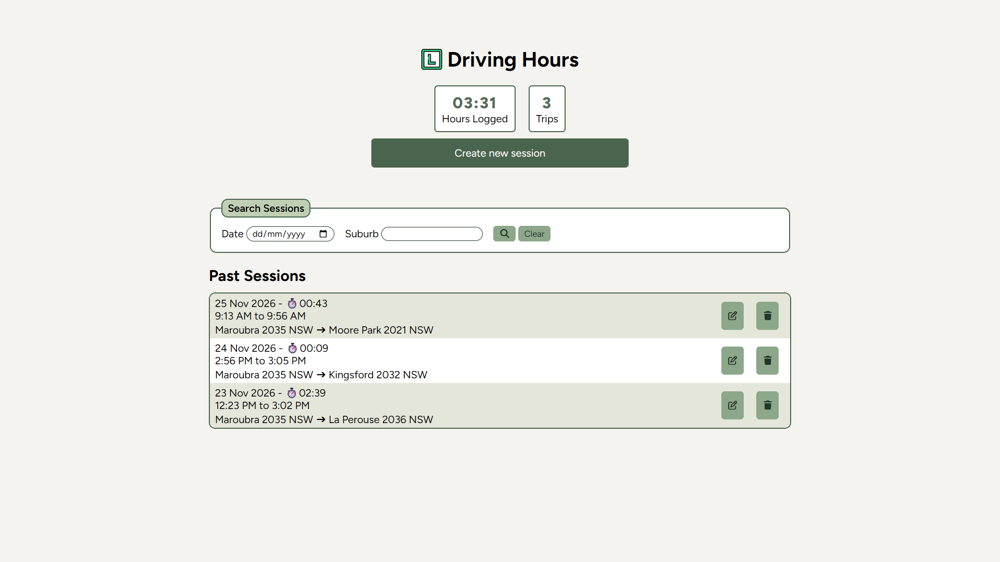

# Learner Hours PWA
A progressive web app designed for learner drivers to record and keep track of the hours they drive.

## Features
- Record individual driving sessions locally
- Automatically track accumulated driving hours
- Enter dates, start/end times
- Enter start/end suburb details
- View, filter and edit recorded driving sessions
- Multiple accounts on the same device
- Basic authentication flows and session management practices
- Cross platform compatibility

## Security
The app was designed with security in mind, with controls to prevent XSS attacks using strict data validation rules and DOMPurify to sanitise user inputs. The app also enforces a secure password policy to mitigate brute force attacks.

### Potential vulnerabilities
The authentication and encryption features of this project are **not suitable for production environments.**

- For learning purposes, the encryption key is exposed in `app.js`, breaching the privacy of user data
- Authentication can be exploited by obtaining password hashes in local storage and passing the hash
